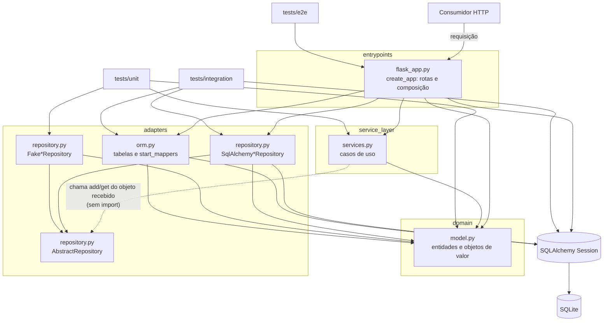
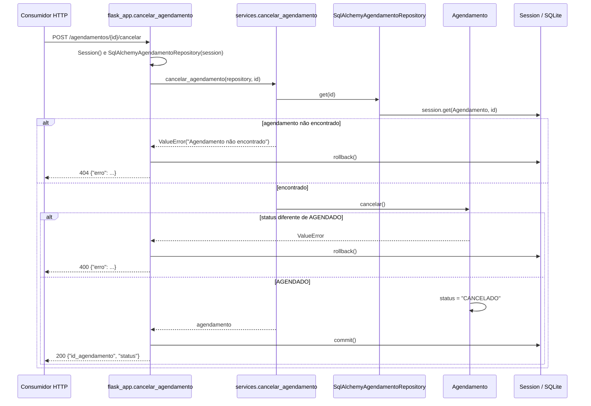

# Arquitetura do Sistema Veterinário

> Documento do Checkpoint 1 da Fase 2 (tag `fase2-checkpoint-1`). Descreve a arquitetura que existe hoje no repositório, avalia seus trade-offs e a compara com uma alternativa. Os cenários e evidências usam principalmente o agregado Agendamento como caso de estudo; os demais integrantes podem acrescentar cenários e evidências dos seus agregados.

## 1. Escopo

O Sistema Veterinário apoia o agendamento de atendimentos veterinários, realizados em clínicas ou a domicílio, tendo o médico veterinário como elemento central. Conforme `PROPOSTA.md` e `README.md`, os usuários previstos são os **clientes (tutores)**, que cadastram seus animais e solicitam agendamentos, e os **médicos veterinários**, que consultam a agenda com data, horário e local dos atendimentos. Na implementação atual, a API HTTP em Flask oferece cadastro de clientes, pacientes, veterinários, disponibilidades e unidades; consulta de cliente, unidade e veterinário por id; e criação e cancelamento de agendamentos. Não há autenticação nem distinção de perfis. Requisitos da proposta como a consulta de agenda pelo veterinário, a duração dos atendimentos, o tempo de deslocamento e o conflito de horários ainda não estão implementados; este documento analisa apenas a arquitetura existente.

## 2. Requisitos arquiteturais

Os atributos abaixo estão em ordem de prioridade para o contexto atual do projeto.

### 2.1 Prioridade 1 — Manutenibilidade

- **Fonte:** desenvolvedor responsável pela evolução do sistema.
- **Estímulo:** alterar uma regra de negócio, por exemplo permitir cancelar também um agendamento `CONFIRMADO`.
- **Ambiente:** manutenção evolutiva, com a suíte de testes disponível.
- **Artefato:** entidade `Agendamento` (`domain/model.py`), caso de uso `cancelar_agendamento()` (`service_layer/services.py`) e endpoint `POST /agendamentos/<id>/cancelar` (`entrypoints/flask_app.py`).
- **Resposta:** a regra muda apenas no domínio; o caso de uso continua só coordenando e a API continua só traduzindo HTTP, sem duplicar a regra.
- **Medida da resposta:** a mudança é feita em no máximo dois arquivos (`domain/model.py` e um teste unitário novo que cubra a transição alterada, falhando antes e passando depois), sem alterar `services.py`, `flask_app.py`, a rota ou o formato JSON; a suíte completa continua passando.

### 2.2 Prioridade 2 — Testabilidade

- **Fonte:** desenvolvedor ou integração contínua.
- **Estímulo:** verificar a criação ou o cancelamento de um agendamento.
- **Ambiente:** execução de testes unitários, sem banco de dados e sem inicializar o mapeamento ORM (`start_mappers()`).
- **Artefato:** caso de uso da Service Layer e entidade `Agendamento`.
- **Resposta:** o caso de uso recebe um `FakeAgendamentoRepository` por parâmetro e é verificado sem sessão SQLAlchemy nem registros persistidos.
- **Medida da resposta:** os testes de `tests/unit/` executam sem criar banco, com tempo de execução por teste desprezível frente ao dos E2E (medição na seção 6), e continuam passando mesmo quando a configuração do ORM está quebrada.

### 2.3 Prioridade 3 — Confiabilidade na validação das operações

- **Fonte:** consumidor da API.
- **Estímulo:** enviar JSON inválido ou incompleto, tentar criar um agendamento com data passada, repetir um `id_agendamento` ou cancelar um agendamento inexistente.
- **Ambiente:** requisição HTTP à API Flask em operação normal.
- **Artefato:** endpoint, caso de uso, entidade de domínio e persistência.
- **Resposta:** a operação inválida é rejeitada, a transação é desfeita (`session.rollback()`) e a API devolve um erro HTTP com corpo `{"erro": ...}`.
- **Medida da resposta:** `ValueError`, `KeyError` ou `TypeError` → HTTP 400; `IntegrityError` na criação → HTTP 409; cancelamento de agendamento inexistente → HTTP 404; nenhum agendamento é gravado com data passada, id repetido ou referência a paciente, veterinário ou unidade inexistente. Cada um desses casos deve ser coberto por um teste E2E que verifique código e corpo da resposta.

### 2.4 Restrições e objetivos

**Restrições:** a disciplina impõe Python 3, pytest, Flask (ou FastAPI) e SQLAlchemy; o grupo escolheu Flask. A persistência usa SQLite (arquivo `sistema_veterinario.db` na aplicação e `sqlite:///:memory:` nos testes de integração e E2E). A CI (`.github/workflows/ci.yml`) roda a suíte com Python 3.14, instalando `requirements.txt`; as medições da seção 6 foram feitas com Python 3.13. A suíte da Fase 1 deve continuar passando após as mudanças da Fase 2, e é proibido reescrever o histórico do Git.

**Objetivos:** manter as regras de negócio no domínio, compreensíveis e testáveis sem banco; evitar duplicação de regras entre endpoints; tornar explícita a fronteira entre HTTP, casos de uso, domínio e persistência. São metas de projeto; a seção 4 mostra onde a implementação ainda não as cumpre.

## 3. Arquitetura atual

### 3.1 Estilos e padrões adotados

- **Arquitetura em camadas:** entrada HTTP (`entrypoints/`), casos de uso (`service_layer/`), modelo de domínio (`domain/`) e adaptadores de persistência (`adapters/`).
- **Domain Model:** entidades e objetos de valor com regras próprias, como o ciclo de vida `AGENDADO → CONFIRMADO → CONCLUIDO` / `AGENDADO → CANCELADO` de `Agendamento`, e a validação de `CPF` e `Telefone`.
- **Service Layer:** funções em `service_layer/services.py` (`criar_agendamento()`, `cancelar_agendamento()`, `cadastrar_cliente()` etc.) coordenam os casos de uso e recebem o repositório por parâmetro.
- **Repository:** `AbstractRepository` define `add()` e `get()`; há implementações SQLAlchemy e falsas (em memória) para cada agregado.
- **Data Mapper (mapeamento imperativo):** `adapters/orm.py` declara as tabelas e mapeia as classes do domínio com `registry.map_imperatively()`, de modo que `domain/model.py` não importa SQLAlchemy.

Há características de **Ports and Adapters**: o domínio não depende de nenhuma outra camada e `services.py` importa apenas `domain.model`, usando o repositório por *duck typing*. A separação é parcial, porém: a "porta" (`AbstractRepository`) fica em `adapters/repository.py`, junto das implementações; os repositórios falsos também ficam nesse módulo de produção, que importa `sqlalchemy.orm.Session`; e `flask_app.py` funciona como raiz de composição, construindo engine, sessão e repositórios concretos e chamando `start_mappers()` dentro de `create_app()`. Portanto, não é uma arquitetura hexagonal estrita.

### 3.2 Componentes e mapeamento para `src/`

| Componente | Localização | Responsabilidade | Depende de |
|---|---|---|---|
| Entrada HTTP | `src/sistema_veterinario/entrypoints/flask_app.py` | Registrar rotas, ler JSON, montar engine, sessão e repositórios, chamar casos de uso, fazer commit/rollback e traduzir exceções em códigos HTTP. | Flask, SQLAlchemy, services, repository, orm, domain |
| Casos de uso | `src/sistema_veterinario/service_layer/services.py` | Coordenar operações: criar/cancelar agendamento, cadastrar/buscar cliente, unidade e veterinário etc. | domain (e o repositório recebido por parâmetro) |
| Domínio | `src/sistema_veterinario/domain/model.py` | Entidades, objetos de valor e regras de negócio. | nenhuma camada do projeto |
| Repositórios | `src/sistema_veterinario/adapters/repository.py` | `AbstractRepository`, repositórios SQLAlchemy e repositórios falsos. | domain, SQLAlchemy |
| Mapeamento ORM | `src/sistema_veterinario/adapters/orm.py` | Tabelas, `start_mappers()` e `metadata`. | domain, SQLAlchemy |
| Testes | `tests/unit/`, `tests/integration/`, `tests/e2e/` | Domínio e serviços com fakes; repositórios com SQLite; API via `test_client()`. | camadas testadas |

### 3.3 Diagrama de componentes

As setas indicam "depende de / importa".

`domain/model.py` não tem setas de saída: é a camada mais estável. A seta pontilhada indica que `services.py` não importa `adapters`; a dependência é só do contrato `add`/`get`. O acoplamento a considerar está em `flask_app.py`, que importa SQLAlchemy diretamente e conhece as implementações concretas de persistência.

### 3.4 Visão de execução: cancelamento de agendamento

A regra de transição fica apenas em `Agendamento.cancelar()`; o caso de uso só busca e delega, e a rota controla a transação e traduz a exceção em código HTTP. A escolha entre 404 e 400 depende do texto da mensagem, ponto discutido na seção 4.1.

## 4. Análise de trade-offs

### 4.1 Contribuição da arquitetura para cada atributo

| Atributo | Contribui | Prejudica / ainda não atendido |
|---|---|---|
| Manutenibilidade | As transições de estado ficam em `Agendamento.cancelar()`; o cenário 2.1 exige mudar só o domínio e seu teste. | O endpoint de cancelamento decide entre 404 e 400 comparando o texto da exceção (`str(erro) == "Agendamento não encontrado"`). Alterar a mensagem em `services.py` muda o contrato HTTP sem nenhum teste falhar, pois não há teste E2E de 404 para agendamento. `flask_app.py` concentra rotas e composição em 612 linhas (`wc -l`). |
| Testabilidade | Serviços recebem o repositório por parâmetro; os 85 testes unitários rodam sem banco (os de serviço com fakes) e sobrevivem até a uma quebra do ORM (seção 6). | O fake não reproduz restrições do banco (por exemplo, chave primária duplicada); essa diferença só aparece nos testes de integração e E2E. |
| Confiabilidade | As rotas de escrita usam `try/except` com `rollback()`; regras de data e estado ficam no domínio e valem para qualquer ponto de entrada. | A tabela `agendamentos` não tem chaves estrangeiras e o caso de uso não verifica as referências, então `POST /agendamentos` com paciente, veterinário e unidade inexistentes responde 201. A medida do cenário 2.3 também não é verificada por testes: os E2E de agendamento cobrem só os casos de sucesso (201 e 200), e em toda a suíte há um único teste de erro HTTP (404 em unidade). Para `KeyError`, o corpo do 400 traz apenas o nome do campo, como `{"erro": "'data_hora'"}`. |

### 4.2 Ponto de trade-off 1 — Separação em camadas × simplicidade

A separação permite testar regras sem API nem banco e mantém o domínio livre de SQLAlchemy. Em troca, cada operação atravessa quatro módulos e cada agregado precisa de entidade, tabela, mapeamento, dois repositórios, caso de uso e rota. O commit `59789a8` criou `flask_app.py` com 138 linhas: cerca de 100 nos dois endpoints de Agendamento, a maior parte tradução de JSON e de exceções, e cerca de 30 de imports, composição e inicialização. Para Agendamento, que tem regras de estado, o custo se justifica; para cadastros quase CRUD, como Unidade, o benefício é menor.

### 4.3 Ponto de trade-off 2 — Repositórios falsos × fidelidade ao banco

O `FakeAgendamentoRepository` (um dicionário) torna os testes de serviço rápidos e isolados. Em troca, ele aceita silenciosamente um `id_agendamento` repetido, enquanto o SQLAlchemy lança `IntegrityError`. A testabilidade ganha à custa da fidelidade, o que obriga a manter testes de integração e E2E como complemento.

### 4.4 Ponto de trade-off 3 — Mapeamento imperativo centralizado × fragilidade de configuração

Manter o mapeamento em `adapters/orm.py` deixa o domínio sem dependência de persistência. O custo é uma configuração central de 180 linhas que precisa ser inicializada uma única vez e de forma compatível com a versão do SQLAlchemy. O commit `4e4c080` (`fix: evita mapeamento ORM duplicado`) envolveu cada um dos seis mapeamentos em um teste `if inspect(...) is None`, preparando `start_mappers()` para ser chamado também por `create_app()`, introduzido no commit seguinte (`59789a8`), além da fixture dos testes de integração. Boa parte das 149 linhas alteradas é reindentação dentro desses `if`.

### 4.5 Riscos

1. **Dependências sem versão fixada (risco confirmado).** `requirements.txt` lista apenas `pytest`, `SQLAlchemy` e `Flask`, sem versões. O mapeamento de `Unidade` usa `composite(..., return_none_on=...)`, aceito pela versão 2.1 do SQLAlchemy. Com SQLAlchemy 2.0.55, a suíte falha com `ArgumentError` (seção 6). Uma instalação com versão anterior à 2.1, local ou na CI, quebra os testes de integração e E2E; o comportamento de versões futuras também não está garantido.
2. **Referências sem integridade no agregado Agendamento.** Como não há chaves estrangeiras nem verificação no caso de uso, um agendamento pode apontar para paciente, veterinário ou unidade inexistentes. Quando as regras de conflito de horário previstas na proposta forem implementadas, elas dependerão dessas referências.
3. **Acoplamento da entrada à persistência concreta.** `flask_app.py` cria engine, sessão e repositórios SQLAlchemy e chama `start_mappers()`. Além disso, a linha `app = create_app()` no fim do módulo faz com que importar `flask_app` crie o arquivo `sistema_veterinario.db` no diretório corrente — isso acontece em toda execução dos testes E2E. Trocar a persistência ou a configuração exige mudar a camada de entrada.

### 4.6 Complemento — Unidade: flexibilidade do atendimento × complexidade da persistência

No agregado **Unidade / Local de Atendimento**, a regra de que unidades físicas precisam de `Endereco`, enquanto unidades com `atende_domicilio=True` podem ter `endereco=None`, fica em `Unidade.__post_init__()`. Isso melhora a **manutenibilidade**, porque a mesma validação vale para a API e para qualquer outro ponto de entrada, sem depender do Flask. O endereço é um objeto de valor imutável, armazenado nas colunas da própria tabela `unidades`, sem entidade ou tabela adicional.

O **trade-off** é que representar corretamente um atendimento domiciliar sem endereço torna a API e a persistência mais complexas: `flask_app.py` precisa aceitar e devolver `None`, e `adapters/orm.py` usa `composite(..., return_none_on=...)` para reconstruir a ausência de endereço. O mapeamento mais simples do banco favorece a organização atual, mas precisaria ser revisto se surgissem requisitos de histórico ou compartilhamento de endereços. Além disso, as colunas anuláveis não impedem, por si só, que uma inserção direta no banco contorne a regra de `Unidade`.

Quanto à **testabilidade e confiabilidade**, `tests/unit/test_unidade_endereco.py` verifica que uma unidade física sem endereço é rejeitada, enquanto `tests/e2e/test_unidade_api.py` verifica o cadastro de unidade domiciliar com `endereco: null`. Ainda falta um teste de integração que salve uma unidade domiciliar sem endereço e a recupere em uma nova sessão, para verificar a reconstrução do `None` pelo ORM. O uso de `return_none_on` também traz o risco de compatibilidade de versões já descrito na seção 4.5.

### 4.7 Complemento — Cliente / Paciente: manutenibilidade e confiabilidade × simplicidade de consulta

No agregado **Cliente / Paciente**, `Cliente` foi definido como raiz do agregado e permanece responsável por controlar sua coleção de pacientes. Essa decisão pode ser observada desde o commit `29e37f3`, que introduziu `Cliente` explicitamente como raiz, e nos testes adicionados em `e4de5de`, que verificam operações relacionadas à coleção de pacientes.

A decisão contribui para a **manutenibilidade**, pois as regras relacionadas à associação entre cliente e paciente ficam centralizadas no domínio. Operações como adicionar, buscar e remover pacientes são responsabilidade de `Cliente`, evitando que diferentes pontos da aplicação precisem implementar novamente essas regras. Por exemplo, a verificação que impede a inclusão de pacientes duplicados é realizada pela própria entidade, independentemente de a operação ter sido iniciada pela API ou por outro ponto de entrada.

Ela também contribui para a **confiabilidade na validação das operações**, porque alterações na coleção de pacientes precisam passar pela raiz do agregado. A camada de serviço não modifica diretamente a coleção: o caso de uso `adicionar_paciente()` recupera o cliente e delega a inclusão para `Cliente.adicionar_paciente()`. Dessa forma, a regra do domínio é aplicada antes da persistência.

Na camada de persistência, os commits `9e6f465` e `6d248c0` introduziram as tabelas e o mapeamento ORM do agregado. O commit `72fc4cc` criou `SqlAlchemyClienteRepository`, sem um repositório separado para `Paciente`. Os pacientes são persistidos e recuperados através do relacionamento com `Cliente`, decisão exercitada pelos testes de integração adicionados em `4242c70`.

O **trade-off** está na simplicidade e na flexibilidade das consultas. Manter uma única porta de persistência para o agregado reduz o número de abstrações e ajuda a preservar sua fronteira, mas torna menos direta uma consulta que precise acessar somente um paciente. Atualmente não existe `SqlAlchemyPacienteRepository`, portanto consultas globais como listar pacientes de determinada raça ou buscar um paciente sem conhecer seu cliente exigiriam uma nova solução.

Esse custo é aceitável para os casos de uso implementados na Fase 1, pois os fluxos existentes trabalham com o paciente dentro do contexto do cliente responsável. Essa escolha também foi reforçada no commit `a807a62`, que removeu o caso de uso independente `buscar_paciente()` da camada de serviço.

Quanto à **testabilidade**, o commit `0cdbe4c` introduziu `FakeClienteRepository`, posteriormente testado em `1bbe0ae`. Os casos de uso de Cliente / Paciente podem, assim, ser exercitados sem inicializar o SQLAlchemy ou acessar um banco de dados. Os testes unitários dos serviços foram adicionados em `4898333`, enquanto os testes E2E de `9b49979` exercitam o fluxo completo com persistência.

Caso `Paciente` passe a possuir um ciclo de vida mais independente, com consultas globais frequentes, prontuário próprio ou operações administrativas que não dependam do cliente, a fronteira atual deverá ser reavaliada. Nesse cenário, criar uma porta de consulta própria ou promover `Paciente` a raiz de outro agregado pode passar a compensar o aumento de complexidade.

## 5. Alternativa arquitetural

A alternativa considerada é **Flask com Active Record** (por exemplo, Flask-SQLAlchemy): as classes herdam do modelo do ORM (`db.Model`), carregam colunas e regras na mesma classe, e as rotas usam diretamente `db.session` e consultas do modelo, sem Repository nem Service Layer.

| Atributo | Atual: camadas + Service Layer + Repository + Data Mapper | Alternativa: Flask com Active Record |
|---|---|---|
| Manutenibilidade | Regra, coordenação, HTTP e persistência ficam em locais distintos; mudar uma regra toca só o domínio. Custo: mais arquivos por agregado e um `orm.py` central a manter. | Menos arquivos e caminho mais curto. Custo: regras, colunas e consultas na mesma classe, e a tendência de a lógica migrar para as rotas. |
| Testabilidade | Domínio e serviços testados com fakes, sem banco; continuam passando mesmo com o ORM quebrado. Integração e E2E ainda são necessários. | Instanciar um modelo exige o ORM configurado, e testar regras normalmente exige uma sessão ou banco de teste. Os testes ficam mais fiéis ao banco, porém mais lentos e acoplados. |
| Confiabilidade | Regras centralizadas no domínio e reaproveitadas por qualquer entrada; depende do wiring correto do ORM e do tratamento de erros nas rotas. | Validações de coluna do ORM ficam perto dos dados, mas regras podem se espalhar entre rotas e modelos, aumentando o risco de inconsistência. |
| Simplicidade (complementar) | Mais indireção e configuração. | Menos abstrações; adequado a CRUD. |

### 5.1 Conclusão

Para este domínio, o grupo escolheria hoje **manter a arquitetura em camadas**. O agregado Agendamento tem regras de estado e de data que precisam valer em qualquer ponto de entrada, e a proposta prevê regras mais complexas (duração, deslocamento, conflitos de horário), que se beneficiam de um domínio testável sem banco. A seção 6 mostra que esse isolamento já protege os testes unitários de falhas de configuração do ORM. A escolha vem com quatro ajustes a avaliar na Fase 2: fixar as versões em `requirements.txt`; garantir a integridade das referências de Agendamento; deixar a composição das dependências explícita fora das rotas e eliminar o `create_app()` executado no import; e trocar a comparação por texto de exceções por exceções de domínio específicas. Para os agregados quase CRUD, uma solução mais simples seria aceitável. A conclusão será revisitada na retrospectiva, com as evidências das refatorações SOLID e dos padrões GoF.

## 6. Evidências do repositório

Contagens obtidas com `git show --stat <hash>` e `wc -l`, no commit `c91fc56` (HEAD de `main` em 20/10/2026; posterior à tag `fase1-entrega` = `9b49979` apenas por alterações em `DECISIONS.md`). Medições feitas em Linux com Python 3.13.16, Flask 3.1.3, pytest 9.1.1 e SQLAlchemy 2.1.5 (versão instalada por `pip install -r requirements.txt` em 20/10/2026).

1. **Um caso de uso entra com seu teste e sem tocar outras camadas.** O commit `b8749b6` (`feat: adiciona casos de uso de agendamento`) alterou 2 arquivos e adicionou 91 linhas: 35 em `service_layer/services.py` e 56 em `tests/unit/test_services_agendamento.py`. Nem o domínio nem os adapters precisaram mudar, porque a entidade, o repositório e o fake (`9a6c4de`) já existiam; a API veio depois, em commit separado.
2. **A tradução HTTP é a maior parte do custo de um endpoint.** O commit `59789a8` (`feat: adiciona API de agendamento`) criou `entrypoints/flask_app.py` com 138 linhas, cerca de 100 delas nos dois endpoints; os casos de uso correspondentes somam 35 linhas. O commit `38f857c` adicionou 69 linhas de testes E2E, cobrindo apenas os caminhos de sucesso.
3. **Testes unitários são mais baratos que os E2E.** Em três execuções de `python -m pytest tests/<pasta> -q`, `tests/unit` rodou 85 testes em 0,25–0,33 s, `tests/e2e` rodou 12 testes em 0,43–0,54 s e `tests/integration`, 6 testes em 0,09 s; a suíte completa tem 103 testes, todos passando. Esses totais são dominados pela coleta e pelos imports. Com `--durations=0`, a soma de setup, execução e teardown é praticamente zero nos 85 testes unitários e 0,13 s nos 12 E2E (cerca de 11 ms por teste, pela criação de um app, banco em memória e requisições). Com só 12 E2E a diferença absoluta é pequena; ela cresce se os E2E passarem a cobrir também os casos de erro.
4. **O FakeRepository isola os testes unitários de falhas do ORM.** Com SQLAlchemy 2.0.55 instalado em um ambiente separado, `tests/unit` continua com 85 testes passando, enquanto os 6 testes de `tests/integration` dão erro e os 4 arquivos de `tests/e2e` falham na coleta com `sqlalchemy.exc.ArgumentError`, causado pelo parâmetro `return_none_on` em `orm.py` (introduzido no commit `bb4a1dd`). Isso comprova o cenário 2.2 e o risco 1 da seção 4.5.
5. **O mapeamento é um ponto central e sensível.** `adapters/orm.py` tem 180 linhas (`wc -l`): as linhas 1–110 contêm imports e as seis declarações de `Table`, e as demais, a função `start_mappers()`. O commit `4e4c080` (`fix: evita mapeamento ORM duplicado`) alterou o arquivo com 95 inserções e 54 remoções para evitar mapeamento duplicado, e o `bb4a1dd` mudou o mapeamento de `Unidade` para aceitar endereço opcional — a mudança que introduziu a dependência da versão 2.1.
6. **A Service Layer não depende de adapters.** `services.py` tem como único import `from sistema_veterinario.domain.model import ...`. Já os quatro arquivos `tests/unit/test_services_*.py` importam os fakes de `sistema_veterinario.adapters.repository`, porque os fakes ficam no código de produção.
7. **A regra de endereço opcional exigiu uma mudança específica no ORM de Unidade.** O commit `3b833f7` introduziu a validação de `Unidade` no domínio; `91cb828` mapeou os campos de `Endereco` com `composite()` na tabela `unidades`, e `bb4a1dd` corrigiu o mapeamento para representar como `None` o endereço ausente. A sequência evidencia o benefício de concentrar a regra no domínio, mas também o custo de manter a persistência coerente com ela.
8. **Os testes verificam a regra por diferentes camadas, mas ainda há uma lacuna.** `test_unidade_fisica_sem_endereco_gera_erro`, em `tests/unit/test_unidade_endereco.py`, exercita a validação diretamente no domínio. O teste `test_api_cadastra_unidade_domiciliar_sem_endereco`, em `tests/e2e/test_unidade_api.py` (introduzido em `7c68eee`), verifica resposta HTTP 201 e `endereco is None`. Já `tests/integration/test_repository_unidade.py` testa a persistência com endereço informado; não há nesse arquivo teste específico de recarga, em uma nova sessão, de unidade domiciliar sem endereço.
9. **Cliente é a porta de persistência do agregado Cliente / Paciente.** O commit `29e37f3` definiu `Cliente` explicitamente como raiz do agregado. Na persistência, `9e6f465` criou as tabelas `clientes` e `pacientes`, `6d248c0` configurou o relacionamento ORM e `72fc4cc` introduziu `SqlAlchemyClienteRepository`, sem criar um repositório separado para `Paciente`. O teste de integração de `4242c70` verifica a persistência e recuperação do cliente juntamente com sua coleção de pacientes.
10. **A camada de aplicação manteve as operações de Paciente centradas na raiz.** O commit `59992c9` introduziu os casos de uso do agregado Cliente / Paciente. Durante a revisão, `a807a62` removeu o caso de uso independente `buscar_paciente()`. A API adicionada em `f05ba5a` oferece `POST /clientes/<id_cliente>/pacientes` para incluir um paciente através do cliente, e os testes E2E de `9b49979` confirmam a persistência realizando posteriormente uma nova consulta ao próprio cliente e verificando sua coleção de pacientes.
11. **O FakeClienteRepository permite testar os casos de uso sem banco de dados.** O commit `0cdbe4c` introduziu `FakeClienteRepository` e `1bbe0ae` adicionou seus testes unitários. Os casos de uso adicionados em `59992c9` são exercitados pelos testes de `4898333` utilizando a implementação em memória, enquanto `4242c70` e `9b49979` permanecem responsáveis por verificar, respectivamente, a persistência real com SQLAlchemy e o fluxo completo da API.