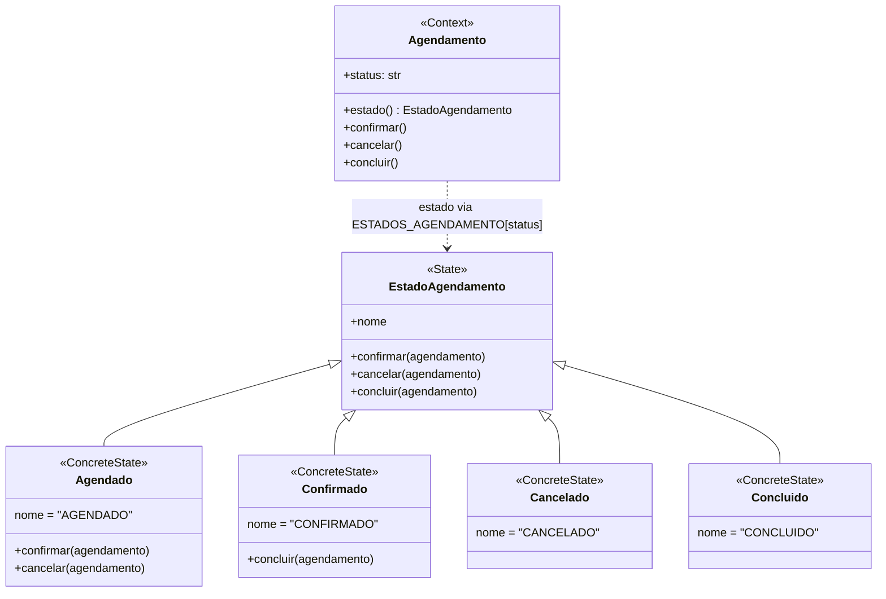

# Padrões GoF

## State — Agendamento (Davi Gesteira dos Anjos Paula)

### Nome e categoria

**State**, padrão **comportamental**.

### Contexto e problema

Um `Agendamento` passa por um ciclo de vida: começa em `AGENDADO`, pode ser confirmado (`CONFIRMADO`) e depois concluído (`CONCLUIDO`), ou cancelado enquanto ainda está `AGENDADO` (`CANCELADO`). Antes do padrão, as regras de transição ficavam em `if` sobre strings dentro de `confirmar()`, `cancelar()` e `concluir()`, e cada método repetia em qual status a ação era permitida (`cancelar` ainda usava um estilo diferente dos outros dois, com `==` e `else`).

O problema é que a regra "qual ação cada status permite e para onde leva" não aparece em lugar nenhum de forma direta: para saber o que um agendamento `CONFIRMADO` pode fazer, é preciso ler os três métodos. Um requisito plausível é registrar a falta do paciente, com um status `NAO_COMPARECEU` alcançável a partir de `CONFIRMADO`. Com o State, isso vira uma classe `NaoCompareceu`, a ação `marcar_falta` em `EstadoAgendamento` (com o erro padrão), a implementação dela em `Confirmado`, o método que delega em `Agendamento` e uma instância na tupla que monta `ESTADOS_AGENDAMENTO`; os estados `Agendado`, `Cancelado` e `Concluido` não mudam.

### Por que State e alternativa considerada

O State coloca em cada estado as ações que ele permite e para qual estado cada uma leva, que é exatamente a regra que estava espalhada pelos `if`.

A alternativa considerada foi uma **tabela de transições** (`{(status, acao): novo_status}`). Ela seria mais curta, mas trata toda transição como uma simples troca de string e não oferece um lugar para comportamento específico de um estado, como uma regra extra ao concluir ou ao marcar falta. Por isso foi descartada.

### Participantes

| Papel no padrão | Classe no código (`src/sistema_veterinario/domain/model.py`) |
|---|---|
| Context | `Agendamento`: guarda `status` e delega `confirmar()`, `cancelar()` e `concluir()` ao objeto devolvido pela propriedade `estado` |
| State | `EstadoAgendamento`: declara as três ações; por padrão, cada uma levanta `ValueError` (transição inválida) |
| ConcreteState | `Agendado`, `Confirmado`, `Cancelado`, `Concluido`: cada um sobrescreve só as ações que permite |

Duas adaptações ao sistema: a string `status` continua sendo o valor persistido pelo SQLAlchemy (objetos carregados do banco não passam por `__init__`), e a propriedade `estado` obtém o objeto de estado pelo dicionário `ESTADOS_AGENDAMENTO`. Como os estados não guardam dados de nenhum agendamento, cada um tem uma única instância compartilhada.

### Diagrama de classes

### Testes

`tests/unit/test_estado_agendamento.py` exercita o padrão:

- `test_agendado_pode_ser_confirmado_e_depois_concluido` e `test_agendado_pode_ser_cancelado` verificam as transições válidas e o estado concreto resultante;
- `test_transicao_invalida_gera_erro_e_mantem_o_status` cobre, de forma parametrizada, as 9 combinações de estado e ação inválidas, verificando que levantam `ValueError` sem alterar o status.

Os testes da Fase 1 que usam `cancelar()` (caso de uso e e2e, este com o agendamento carregado do banco) continuam passando sem alteração.

### Custo

- Cinco classes no lugar de três métodos com `if`, e a regra de transição passa a ficar distribuída entre elas.
- O dicionário `ESTADOS_AGENDAMENTO` precisa ser mantido em sincronia com os nomes dos estados; um status desconhecido no banco levanta `KeyError`.
- O objeto de estado é obtido a partir da string a cada acesso, pois a fonte de verdade continua sendo o `status` persistido.

O custo compensa porque o ciclo de vida é a principal regra do agregado Agendamento e é a parte com maior chance de mudar (novos status, novas transições).
