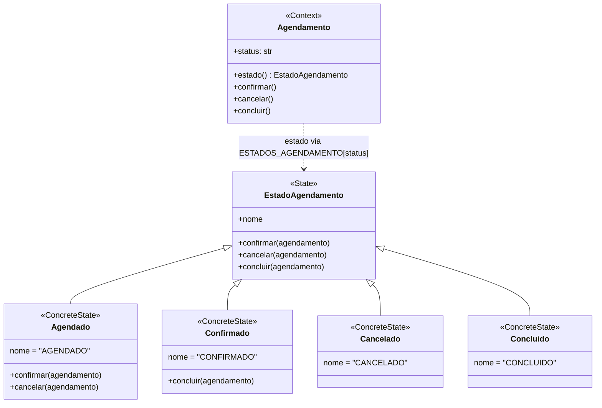
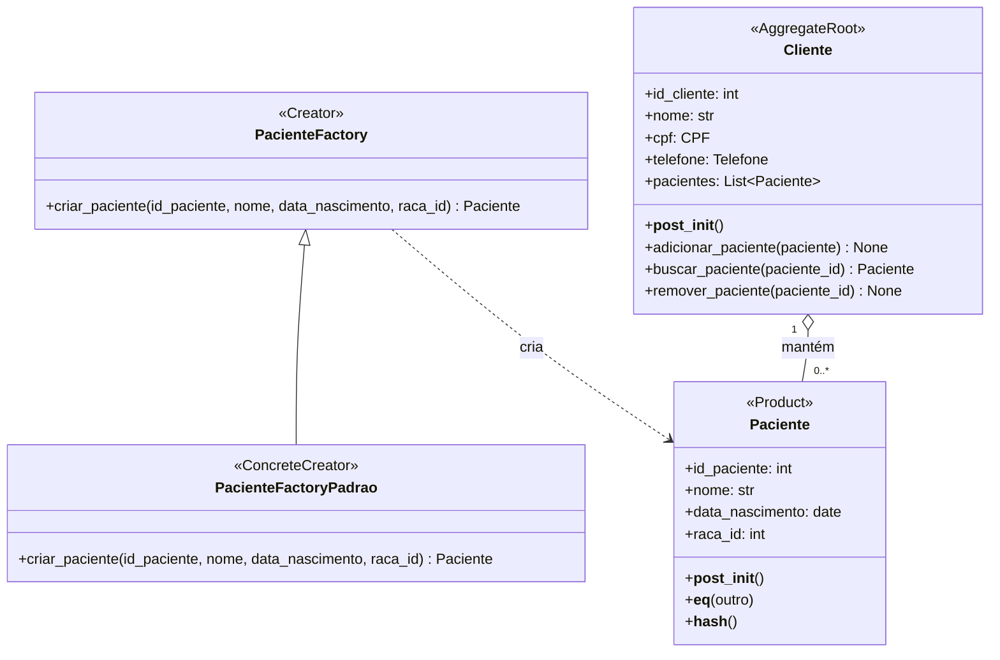

# Padrões GoF

## State — Agendamento (Davi Gesteira dos Anjos Paula)

### Nome e categoria

**State**, padrão **comportamental**.

### Contexto e problema

Um `Agendamento` passa por um ciclo de vida: começa em `AGENDADO`, pode ser confirmado (`CONFIRMADO`) e depois concluído (`CONCLUIDO`), ou cancelado enquanto ainda está `AGENDADO` (`CANCELADO`). Antes do padrão, as regras de transição ficavam em `if` sobre strings dentro de `confirmar()`, `cancelar()` e `concluir()`, e cada método repetia em qual status a ação era permitida (`cancelar` ainda usava um estilo diferente dos outros dois, com `==` e `else`).

O problema é que a regra "qual ação cada status permite e para onde leva" não aparece em lugar nenhum de forma direta: para saber o que um agendamento `CONFIRMADO` pode fazer, é preciso ler os três métodos. Um requisito plausível é registrar a falta do paciente, com um status `NAO_COMPARECEU` alcançável a partir de `CONFIRMADO`. Com o State, isso vira uma classe `NaoCompareceu`, a ação `marcar_falta` em `EstadoAgendamento` (com o erro padrão), a implementação dela em `Confirmado`, o método que delega em `Agendamento` e uma instância na tupla que monta `ESTADOS_AGENDAMENTO`; os estados `Agendado`, `Cancelado` e `Concluido` não mudam.

### Por que State e alternativa considerada

O State coloca em cada estado as ações que ele permite e para qual estado cada uma leva, que é exatamente a regra que estava espalhada pelos `if`.

A alternativa considerada foi uma **tabela de transições** (`{(status, acao): novo_status}`). Ela seria mais curta, mas trata toda transição como uma simples troca de string e não oferece um lugar para comportamento específico de um estado, como uma regra extra ao concluir ou ao marcar falta. Por isso foi descartada.

### Participantes

| Papel no padrão | Classe no código (`src/sistema_veterinario/domain/model.py`) |
|---|---|
| Context | `Agendamento`: guarda `status` e delega `confirmar()`, `cancelar()` e `concluir()` ao objeto devolvido pela propriedade `estado` |
| State | `EstadoAgendamento`: declara as três ações; por padrão, cada uma levanta `ValueError` (transição inválida) |
| ConcreteState | `Agendado`, `Confirmado`, `Cancelado`, `Concluido`: cada um sobrescreve só as ações que permite |

Duas adaptações ao sistema: a string `status` continua sendo o valor persistido pelo SQLAlchemy (objetos carregados do banco não passam por `__init__`), e a propriedade `estado` obtém o objeto de estado pelo dicionário `ESTADOS_AGENDAMENTO`. Como os estados não guardam dados de nenhum agendamento, cada um tem uma única instância compartilhada.

### Diagrama de classes



### Testes

`tests/unit/test_estado_agendamento.py` exercita o padrão:

- `test_agendado_pode_ser_confirmado_e_depois_concluido` e `test_agendado_pode_ser_cancelado` verificam as transições válidas e o estado concreto resultante;
- `test_transicao_invalida_gera_erro_e_mantem_o_status` cobre, de forma parametrizada, as 9 combinações de estado e ação inválidas, verificando que levantam `ValueError` sem alterar o status.

Os testes da Fase 1 que usam `cancelar()` (caso de uso e e2e, este com o agendamento carregado do banco) continuam passando sem alteração.

### Custo

- Cinco classes no lugar de três métodos com `if`, e a regra de transição passa a ficar distribuída entre elas.
- O dicionário `ESTADOS_AGENDAMENTO` precisa ser mantido em sincronia com os nomes dos estados; um status desconhecido no banco levanta `KeyError`.
- O objeto de estado é obtido a partir da string a cada acesso, pois a fonte de verdade continua sendo o `status` persistido.

O custo compensa porque o ciclo de vida é a principal regra do agregado Agendamento e é a parte com maior chance de mudar (novos status, novas transições).

## Factory Method — Agregado Cliente/Paciente (David Pereira Ramos)

### Nome e categoria

**Factory Method**, padrão **criacional**.

### Contexto e problema

No agregado Cliente/Paciente, a classe `Cliente` representa a raiz do agregado e é responsável por controlar a associação dos pacientes por meio do método `adicionar_paciente()`.

Antes da aplicação do padrão, a criação de uma instância de `Paciente` acontecia diretamente na função `adicionar_paciente()`, localizada em `src/sistema_veterinario/service_layer/services.py`. O serviço instanciava diretamente a classe `Paciente` e, em seguida, entregava o objeto criado à raiz `Cliente` para realizar a associação.

Embora essa implementação funcionasse, a camada de serviços conhecia diretamente a classe concreta utilizada na criação e os parâmetros necessários para sua construção. Caso a implementação responsável pela criação precisasse ser substituída, o serviço dependeria de alterações relacionadas à instanciação da entidade.

O problema tratado é, portanto, o acoplamento da camada de serviços à construção concreta de `Paciente`, e não uma falha nas regras de validação ou associação do agregado.

Para reduzir esse acoplamento, foi introduzida uma abstração de criação, permitindo que o serviço solicite a construção do paciente por meio de um contrato, sem instanciar diretamente a entidade.

### Por que Factory Method e alternativa considerada

O Factory Method foi escolhido para separar a responsabilidade de criação de pacientes da coordenação do caso de uso na camada de serviços.

A classe abstrata `PacienteFactory` define o contrato de criação por meio do método `criar_paciente()`. A classe `PacienteFactoryPadrao` implementa esse método e realiza a instanciação concreta de `Paciente`.

Na função `adicionar_paciente()`, a fábrica é recebida pelo parâmetro opcional `paciente_factory`. Quando nenhuma implementação é fornecida, o serviço utiliza `PacienteFactoryPadrao` como implementação padrão.

Dessa forma, o serviço passa a depender da abstração `PacienteFactory`, permitindo receber outra implementação que respeite o mesmo contrato, sem precisar modificar o fluxo principal do caso de uso.

A escolha também preserva a responsabilidade da raiz do agregado: a fábrica cria o paciente, enquanto `Cliente` continua responsável por validar a associação, impedir identificadores duplicados e manter sua coleção de pacientes.

A alternativa considerada foi manter a instanciação direta de `Paciente` dentro da função `adicionar_paciente()`. Essa abordagem é mais simples e possui menos classes, mas mantém o serviço diretamente acoplado à construção concreta da entidade.

Também foi considerada a possibilidade de colocar um método de criação diretamente na classe `Cliente`. Essa alternativa manteria a criação dentro da raiz do agregado, mas não apresentaria a separação entre Creator abstrato e implementação concreta adotada na solução.

A solução escolhida permite substituir a implementação responsável pela criação por meio de injeção de dependência, preservando as responsabilidades já existentes no agregado.

Atualmente, existe apenas uma implementação concreta de produção, `PacienteFactoryPadrao`, e um único tipo concreto de produto, `Paciente`. Portanto, a possibilidade de substituição da fábrica está implementada, mas ainda não existem diferentes modalidades de criação de pacientes previstas no domínio atual.

### Participantes

| Papel no padrão | Classe no código (`src/sistema_veterinario/domain/model.py`) |
|---|---|
| Creator | `PacienteFactory`: define o método abstrato `criar_paciente()`, estabelecendo o contrato de criação. |
| ConcreteCreator | `PacienteFactoryPadrao`: implementa `criar_paciente()` e instancia a entidade `Paciente`. |
| Product | `Paciente`: representa o objeto produzido pela fábrica, contendo seus atributos e validações de domínio. |

A classe `Paciente` é o único tipo concreto de produto utilizado atualmente. Não existe uma hierarquia de produtos concretos nesta implementação, pois todos os pacientes são representados pela mesma classe de domínio.

A classe `Cliente` não é participante direto do padrão. Ela continua sendo a raiz do agregado, responsável pela associação dos pacientes por meio de `adicionar_paciente()`.

Nos testes, a classe `PacienteFactoryEspia`, definida em `tests/unit/test_services_cliente.py`, implementa o contrato `PacienteFactory` para registrar as chamadas recebidas e verificar se o serviço utiliza corretamente a fábrica injetada. Ela é uma implementação utilizada exclusivamente nos testes, não uma fábrica adicional de produção.

### Diagrama de classes



### Testes

`tests/unit/test_paciente_factory.py` exercita o padrão:

- `test_factory_padrao_cria_paciente_valido` verifica se a fábrica padrão cria uma instância de `Paciente` e preserva corretamente os atributos recebidos;
- `test_factory_padrao_respeita_validacoes_do_paciente` utiliza parametrização com `pytest.mark.parametrize` para verificar sete situações inválidas, incluindo identificador zero, negativo, nulo ou não numérico, nome vazio, data de nascimento futura e identificador de raça zero.

`tests/unit/test_services_cliente.py` verifica a integração da fábrica com a camada de serviços:

- `test_adicionar_paciente` verifica a utilização da fábrica padrão quando nenhuma fábrica é fornecida e confirma que o objeto retornado é o mesmo associado ao cliente;
- `test_adicionar_paciente_utiliza_factory_injetada` utiliza `PacienteFactoryEspia` para verificar se o serviço realmente utiliza a fábrica recebida e encaminha os parâmetros corretos;
- `test_adicionar_paciente_com_cliente_inexistente_gera_erro` verifica se a operação é interrompida quando o cliente não existe e se a fábrica não chega a ser chamada.

A suíte completa de testes foi executada após as alterações, apresentando o seguinte resultado:

```text
147 passed in 30.76s
```

### Custo

- Duas classes adicionais (`PacienteFactory` e `PacienteFactoryPadrao`) para separar o contrato de criação de sua implementação concreta.
- Inclusão do parâmetro opcional `paciente_factory` na função `adicionar_paciente()`.
- Introdução de uma abstração adicional entre a camada de serviços e a construção de `Paciente`.
- Necessidade de manter o contrato da fábrica e suas implementações.
- Maior indireção durante o processo de criação dos pacientes.

A implementação também possui uma limitação: atualmente existe somente uma fábrica concreta de produção e um único tipo concreto de produto. Assim, a substituição da implementação de criação é possível, mas ainda não é utilizada para produzir diferentes tipos de pacientes no domínio atual.

O custo foi aceito para separar a construção da entidade da coordenação do caso de uso, permitindo substituir a fábrica sem modificar o fluxo principal do serviço. A raiz `Cliente` permanece responsável por proteger a integridade do agregado e controlar a associação dos pacientes.